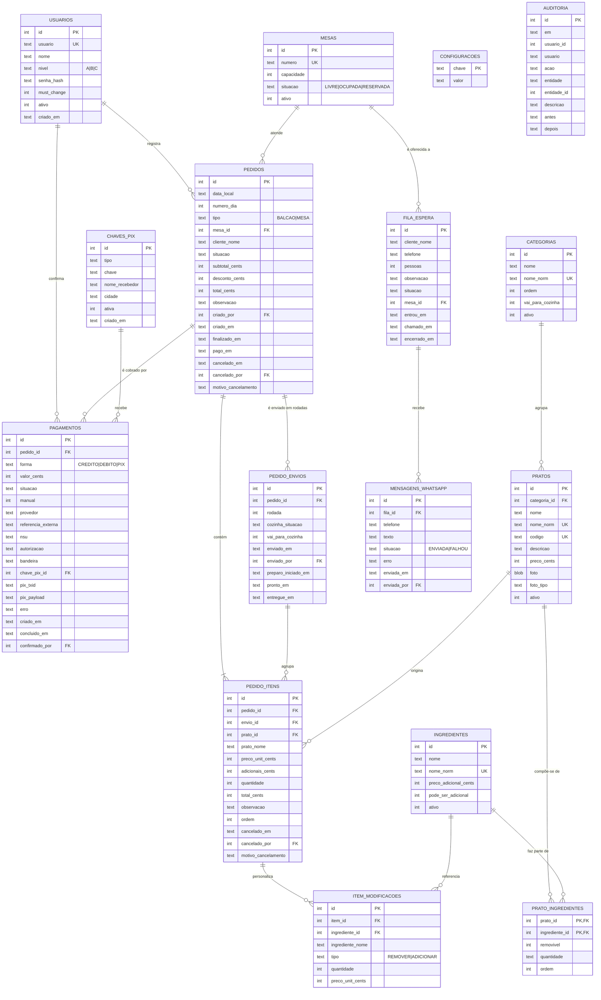

# Banco de dados

SQLite via `node:sqlite` (embutido no Node.js ≥ 22.13, sem dependência nativa). Arquivo: `pdv.sqlite`.

| Modo | Local |
| --- | --- |
| Aplicativo instalado | `%APPDATA%\pdv-restaurante\pdv.sqlite` (preservado ao desinstalar/reinstalar/atualizar) |
| `npm start` | `data/pdv.sqlite` (ou o caminho da variável `PDV_DB`) |
| Testes | `:memory:` |

Configuração da conexão: `journal_mode = WAL`, `foreign_keys = ON`, `busy_timeout = 5000`.

Convenções:
- Chave primária `id INTEGER PRIMARY KEY` (autoincremento implícito do SQLite).
- Dinheiro em **centavos inteiros** com sufixo `_cents`.
- Data/hora em texto ISO 8601 UTC (`2026-10-23T14:05:00.000Z`); data local do pedido em `data_local` (`AAAA-MM-DD`) para numeração e filtros.
- Booleanos como `INTEGER` 0/1 com `CHECK`.
- Situações como texto curto com `CHECK (... IN (...))`.
- Nada de exclusão física em pedidos, pagamentos e auditoria.

## DER



`CONFIGURACOES` e `AUDITORIA` não têm relacionamentos de chave estrangeira (de propósito: a auditoria sobrevive à exclusão de usuários).

## Tabelas

### `usuarios`
| Campo | Tipo | Regra |
| --- | --- | --- |
| `usuario` | TEXT | único, sem diferenciar maiúsculas (`COLLATE NOCASE`) |
| `nivel` | TEXT | `CHECK (nivel IN ('A','B','C'))` — C = Cozinha |
| `senha_hash` | TEXT | scrypt + sal (`scrypt$N$sal$hash`) |
| `must_change` | INTEGER | 1 = senha provisória |
| `ativo` | INTEGER | usuário inativo não faz login |

### `categorias`, `ingredientes`, `pratos`, `prato_ingredientes`
- `nome_norm` (nome em minúsculas e sem acento) é `UNIQUE` em `categorias`, `ingredientes` e `pratos`; `nome` guarda o texto original.
- `ingredientes.preco_adicional_cents >= 0`; `pratos.preco_cents > 0`.
- `prato_ingredientes`: chave primária composta `(prato_id, ingrediente_id)`; `ON DELETE CASCADE` a partir de `pratos`;
  `ON DELETE RESTRICT` a partir de `ingredientes`.
- `pratos.categoria_id` com `ON DELETE RESTRICT`.
- `pratos.foto`: imagem PNG/JPEG/WebP sem limite de tamanho (opcional); `pratos.foto_tipo` guarda o tipo MIME.

### `mesas`
`situacao CHECK IN ('LIVRE','OCUPADA','RESERVADA')`.

### `pedidos`
| Campo | Regra |
| --- | --- |
| `data_local` + `numero_dia` | `UNIQUE (data_local, numero_dia)`; número calculado como `MAX(numero_dia)+1` do dia, dentro da mesma transação da inserção |
| `situacao` | `CHECK IN ('ABERTO','AGUARDANDO_PAGAMENTO','PAGO','CANCELADO')` |
| `tipo` | `CHECK IN ('BALCAO','MESA')` |
| identificação | `CHECK ((tipo = 'MESA' AND mesa_id IS NOT NULL) OR (tipo = 'BALCAO' AND cliente_nome IS NOT NULL))` |
| uma comanda por mesa | `CREATE UNIQUE INDEX ux_comanda_aberta ON pedidos(mesa_id) WHERE tipo = 'MESA' AND situacao IN ('ABERTO','AGUARDANDO_PAGAMENTO')` |
| totais | `CHECK (total_cents = subtotal_cents - desconto_cents AND desconto_cents BETWEEN 0 AND subtotal_cents)` |

### `pedido_envios` (rodadas para a cozinha)
| Campo | Regra |
| --- | --- |
| `rodada` | 1, 2, 3… por pedido; `UNIQUE (pedido_id, rodada)` |
| `vai_para_cozinha` | 0 quando a rodada só tem itens de categorias que não vão à cozinha (não aparece no andon) |
| `cozinha_situacao` | `CHECK IN ('NA_FILA','EM_PREPARO','PRONTO','ENTREGUE')`; horários de cada etapa nos campos `*_em` |

### `pedido_itens` e `item_modificacoes`
- `envio_id` `NULL` = item **pendente de envio** (editável). Preenchido = já enviado (só pode ser cancelado).
- Item cancelado: `cancelado_em`/`cancelado_por`/`motivo_cancelamento` preenchidos; não entra no `subtotal`.
- Guardam o **retrato** (`prato_nome`, `preco_unit_cents`, `ingrediente_nome`, `preco_unit_cents` do adicional).
- `prato_id`/`ingrediente_id` com `ON DELETE RESTRICT` (pratos e ingredientes usados são só desativados).
- `pedido_itens.total_cents = (preco_unit_cents + adicionais_cents) * quantidade`.
- `item_modificacoes`: `UNIQUE (item_id, ingrediente_id)` (um ingrediente não pode ser removido e adicionado no mesmo item);
  para `REMOVER`, `quantidade = 1` e `preco_unit_cents = 0`.

### `chaves_pix`
Índice único parcial garante uma só ativa: `CREATE UNIQUE INDEX ux_chave_pix_ativa ON chaves_pix(ativa) WHERE ativa = 1`.

### `pagamentos`
| Campo | Regra |
| --- | --- |
| `situacao` | `CHECK IN ('PENDENTE','APROVADO','RECUSADO','CANCELADO','EXPIRADO')` |
| pendente único | `CREATE UNIQUE INDEX ux_pagamento_pendente ON pagamentos(pedido_id) WHERE situacao = 'PENDENTE'` |
| aprovado único | `CREATE UNIQUE INDEX ux_pagamento_aprovado ON pagamentos(pedido_id) WHERE situacao = 'APROVADO'` |
| `manual` | 1 = contingência (cobrado fora da integração) ou PIX confirmado pelo atendente |
| `provedor` | adaptador usado: `simulado`, `pagbank_smart` ou `manual` |
| `pix_payload` | o BR Code exato exibido ao cliente |

### `fila_espera` e `mensagens_whatsapp`
- `fila_espera.situacao CHECK IN ('AGUARDANDO','CHAMADO','SENTADO','DESISTIU','NAO_COMPARECEU')`.
- `telefone` normalizado em E.164 (`+5511999998888`); anonimizado após 30 dias (job ao abrir o sistema).

### `configuracoes`
Chave/valor. Chaves previstas:

| Chave | Exemplo |
| --- | --- |
| `restaurante.nome` | `Restaurante Bom Sabor` |
| `whatsapp.modelo_chamada` | `Olá {nome}! Sua mesa {mesa} no {restaurante} está pronta. Aguardamos você em até {tolerancia} minutos.` |
| `fila.tolerancia_min` | `10` |
| `maquininha.provedor` | `simulado` |
| `maquininha.config` | JSON específico do provedor (sem segredos em texto puro: ver [Arquitetura → Segurança](arquitetura.md#segurança)) |
| `maquininha.timeout_s` | `120` |
| `pix.validade_min` | `15` |
| `cozinha.enviar_em` | `PAGO` ou `FINALIZADO` (só pedidos de balcão) |
| `rede.porta_local` | `8420` — porta na rede local para tablet do andon e Moderninha Smart |
| `cozinha.alerta_min` / `cozinha.critico_min` | `10` / `20` |
| `cozinha.som` | `1` |

### `auditoria`
Imutável: gatilhos `BEFORE UPDATE` e `BEFORE DELETE` executam `RAISE(ABORT, 'auditoria é imutável')`.

## Índices

| Índice | Uso |
| --- | --- |
| `pedidos(data_local, id)` | lista de pedidos do dia em ordem de cadastro |
| `pedidos(situacao)` | filtros |
| `pedido_envios(cozinha_situacao, enviado_em) WHERE vai_para_cozinha = 1 AND cozinha_situacao <> 'ENTREGUE'` | andon da cozinha |
| `pedido_envios(pedido_id)` | rodadas do pedido |
| `pedido_itens(pedido_id)` | detalhes do pedido |
| `pagamentos(pedido_id)` | histórico de cobranças |
| `fila_espera(situacao, entrou_em)` | próximo da fila |
| `auditoria(em)`, `auditoria(entidade, entidade_id)` | consultas de auditoria |

## Migrações

`src/infrastructure/database/migrations.js`: lista ordenada; a versão aplicada fica em `PRAGMA user_version`.
Ao abrir o banco, as pendentes rodam automaticamente, cada uma em transação. Nunca editar uma migração publicada: acrescentar outra no final.

| # | Mudança |
| --- | --- |
| 1 | Usuários (níveis A/B/C), configurações, auditoria + gatilhos |
| 2 | Cardápio: categorias (com `vai_para_cozinha`), ingredientes, pratos, prato_ingredientes |
| 3 | Mesas, fila de espera, mensagens do WhatsApp |
| 4 | Pedidos (balcão e mesa), rodadas (`pedido_envios`), itens, modificações |
| 5 | Chaves PIX e pagamentos |
| 8 | Ingredientes sem unidade de medida (`DROP COLUMN unidade_medida`) |

## Consulta de referência: lista de pedidos

```sql
SELECT p.id, p.numero_dia, p.criado_em, p.tipo, m.numero AS mesa, p.cliente_nome,
       (SELECT SUM(quantidade) FROM pedido_itens i WHERE i.pedido_id = p.id AND i.cancelado_em IS NULL) AS qtd_itens,
       p.total_cents, p.situacao,
       (SELECT forma FROM pagamentos g WHERE g.pedido_id = p.id AND g.situacao = 'APROVADO') AS forma,
       u.usuario AS atendente
FROM pedidos p
LEFT JOIN mesas m ON m.id = p.mesa_id
JOIN usuarios u ON u.id = p.criado_por
WHERE p.data_local BETWEEN :de AND :ate
ORDER BY p.id ASC;
```
