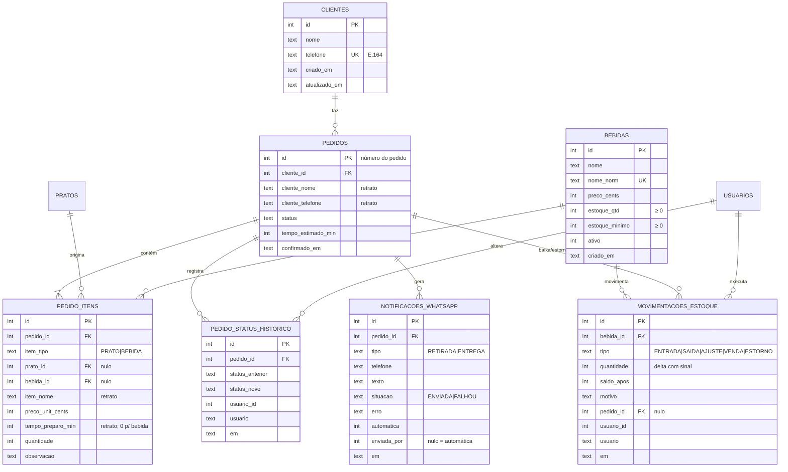
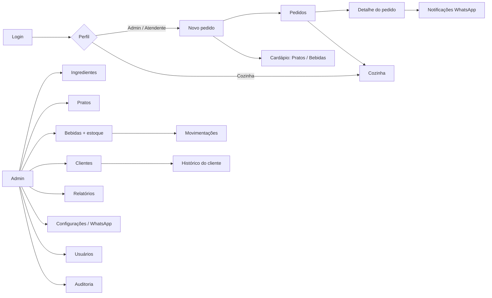

# Escopo Lanchonete — design (delta sobre o projeto atual)

**Data:** 2026-10-26 · **Origem:** novo texto de requisitos do usuário (sistema de restaurante/lanchonete) · **Decisões do usuário:**
(1) estender o projeto atual (Node/Electron/SQLite) em vez de reescrever em .NET/WPF; (2) mesas, fila de espera, PIX e maquininha ficam para
uma **fase posterior** (o que já existe de mesas permanece no código, sem tela nova).

Este documento é a fonte de verdade do que **muda** em relação a `docs/` (que descreve o escopo anterior). Onde houver conflito, vale este.

## 1. Objetivo

Sistema desktop (Windows) para lanchonete/restaurante que registra pedidos de clientes identificados (nome + telefone), controla cardápio de pratos e
bebidas com estoque, leva o pedido à cozinha por um fluxo de status rastreável, avisa o cliente pelo WhatsApp quando o pedido fica pronto e gera
relatórios (PDF/Excel). Funciona offline (SQLite local); só o WhatsApp precisa de internet.

**Não-objetivos (adiados):** mesas/comanda, fila de espera, PIX, maquininha de cartão, andon por "rodada". **Anti-objetivos:** perder estoque
(venda de bebida sem saldo; saldo negativo), enviar WhatsApp duplicado sem o atendente saber, mudar status sem registrar quem mudou.

## 2. Mapa de requisitos

| Requisito do usuário | Situação no código | Trabalho |
| --- | --- | --- |
| Título da janela com nome e versão | `electron-main.js` fixa o título | **novo**: `PDV Restaurante — v{versão}` (RF-GERAL) |
| Crédito "Desenvolvido por Kaio Gomes" → https://kaio-gomes-site.vercel.app/ | nada | **novo**: rodapé em todas as telas + Sobre |
| Cardápio (pratos e aba Bebidas, busca e filtros) | cadastro de pratos existe; sem tela de consulta | **novo**: tela Cardápio com abas |
| Ingredientes: nome, unidade de medida, observação | ingredientes têm nome e preço de adicional | **adaptar**: + `unidade_medida`, `observacao` |
| Pratos: valor, tempo de preparo, ≥ 1 ingrediente, ativar/inativar | pratos sem tempo; aceita 0 ingredientes | **adaptar**: + `tempo_preparo_min`, ≥ 1 ingrediente |
| Bebidas e estoque (entrada/saída/ajuste, histórico, alerta, bloqueio) | nada | **novo** |
| Pedido com cliente (nome + telefone), itens prato/bebida, observação por item, totais, tempo estimado | pedido sem cliente cadastrado; itens só de prato | **adaptar** |
| Status do pedido + histórico (data, hora, usuário) | situações de pagamento (ABERTO/PAGO...) | **adaptar** (novo fluxo, ver §4) |
| Cozinha: tela dedicada, ordem cronológica, muda status | não existe tela | **novo** (substitui o andon por rodada) |
| WhatsApp automático ao ficar pronto, reenvio, histórico, falhas, modelos | nada (tabela de fila não serve) | **novo** |
| Histórico de clientes | nada | **novo** |
| Relatórios + PDF/Excel | nada | **novo** |
| Perfis Admin / Atendente / Cozinha | níveis A / B / C já existem | **adaptar** permissões (§5) |
| Logging estruturado, migrações automáticas, DI, camadas | migrações e DI existem; log simples | **novo**: log JSON em arquivo |
| Scripts de criação do banco, DER, fluxo de telas | DER do escopo antigo | **novo**: `docs/schema.sql` gerado do banco real + DER atualizado |

## 2.1 Equivalência com a sugestão técnica (.NET)

| Sugestão | Aqui |
| --- | --- |
| Clean Architecture / SOLID | camadas `domain / application / infrastructure / presentation`, ligação só no `compositionRoot` (já existe) |
| MVVM + WPF/WinUI | SPA em JS puro dentro do Electron (módulos de view + `api.js`); sem framework |
| EF Core + migrações automáticas | `node:sqlite` + `migrations.js` aplicadas na abertura (já existe) |
| Injeção de dependência | construtores recebem portas; instâncias só no `compositionRoot` |
| Logging estruturado | `JsonLineLogger` (JSON por linha, rotação diária, 14 arquivos) |
| WhatsApp (whatsapp-web.js) | nativo em Node; sem ponte extra |

## 3. Modelo de dados (mudanças)

Bancos de desenvolvimento antigos devem ser apagados (nada foi liberado). As migrações 2 e 4 podem ser editadas no lugar; tabelas **novas** entram na migração 5.



Alterações em tabelas existentes:

| Tabela | Mudança |
| --- | --- |
| `ingredientes` | + `unidade_medida TEXT NOT NULL` (UN, G, KG, ML, L, COLHER, FATIA, PORCAO), + `observacao TEXT`. `preco_adicional_cents` e `pode_ser_adicional` permanecem (personalização por ingrediente continua disponível) |
| `pratos` | + `tempo_preparo_min INTEGER NOT NULL CHECK (> 0)` |
| `pedidos` | `status` com `CHECK IN ('ABERTO','RECEBIDO','EM_PREPARO','PRONTO_RETIRADA','PRONTO_ENTREGA','FINALIZADO','CANCELADO')` (substitui as situações de pagamento, que voltam com a fase de pagamento); `cliente_id` obrigatório ao confirmar; `cliente_nome`/`cliente_telefone` como retrato; `tempo_estimado_min`; `confirmado_em`. `mesa_id` e `tipo` permanecem para a fase de mesas, mas só `BALCAO` é usado |
| `pedido_itens` | `prato_id` passa a nulo; + `bebida_id`, `item_tipo`, `tempo_preparo_min`; `prato_nome` vira `item_nome`; `CHECK` de que exatamente um entre `prato_id` e `bebida_id` está preenchido |
| `pedido_envios` | permanece sem uso (rodadas voltam com mesas) |

Número do pedido: passa a ser o **`id` global crescente** (exigência "número único"; ex.: nº 1025). `numero_dia` deixa de ser exibido.

## 4. Fluxo de status

```
ABERTO (rascunho) ──confirmar──▶ RECEBIDO ──▶ EM_PREPARO ──▶ PRONTO_RETIRADA ──▶ FINALIZADO
                                   │             │      └──▶ PRONTO_ENTREGA ──▶ FINALIZADO
                                   │             └── (volta) PRONTO_* ──▶ EM_PREPARO
                                   └── reabrir (estorna estoque) ──▶ ABERTO
 ABERTO / RECEBIDO / EM_PREPARO / PRONTO_* ──cancelar (motivo)──▶ CANCELADO     (FINALIZADO não cancela na v1)
```

Regras:
- **Confirmar** (ABERTO → RECEBIDO), numa só transação: nome e telefone do cliente obrigatórios (telefone normalizado E.164); ≥ 1 item; para cada bebida, baixa de estoque com `UPDATE … WHERE estoque_qtd >= :qtd` (saldo insuficiente → 409 listando as bebidas); cria/atualiza o cliente pelo telefone; grava `confirmado_em`, `tempo_estimado_min` e o primeiro registro de histórico.
- **Reabrir** (RECEBIDO → ABERTO): só enquanto a cozinha não iniciou; estorna o estoque (movimento `ESTORNO`); é o caminho de "atualizar pedido".
- **Cancelar**: exige motivo (≤ 200); estorna o estoque se já havia sido baixado.
- Toda mudança grava `pedido_status_historico` (anterior, novo, usuário, instante UTC) **na mesma transação**; eventos SSE e WhatsApp só depois do commit.
- Tempo estimado = **máximo** do `tempo_preparo_min` dos pratos do pedido (a cozinha prepara em paralelo); `SOMA` configurável em `cozinha.estimativa` (`MAXIMO` | `SOMA`).

## 5. Permissões

| Ação | Admin (A) | Atendente (B) | Cozinha (C) |
| --- | --- | --- | --- |
| Cadastros (ingredientes, pratos, bebidas), estoque, relatórios, configurações, usuários | ✔ | — | — |
| Consultar cardápio e estoque | ✔ | ✔ | — |
| Criar, editar rascunho, confirmar, reabrir, cancelar pedido | ✔ | ✔ | — |
| Consultar pedidos e clientes | ✔ | ✔ | pedidos ativos (somente leitura) |
| Mudar status RECEBIDO → EM_PREPARO → PRONTO_* → FINALIZADO (e PRONTO_* → EM_PREPARO) | ✔ | FINALIZADO apenas | ✔ |
| Reenviar WhatsApp | ✔ | ✔ | — |

## 6. WhatsApp

- Ao entrar em `PRONTO_RETIRADA` ou `PRONTO_ENTREGA`, o `NotificacaoService` envia **automaticamente**, depois do commit e sem bloquear a resposta; o resultado vira registro em `notificacoes_whatsapp` (`ENVIADA`/`FALHOU` + erro) e evento SSE `notificacao` (a interface avisa as falhas).
- Falha de envio **nunca** reverte o status; não há reenvio automático; o atendente usa **Reenviar** (nova linha de histórico, `automatica = 0`).
- Modelos (config, com `{nome}` = primeiro nome e `{numero}`):
  - retirada: `Olá, {nome}!\n\nSeu pedido nº {numero} está pronto para retirada.\n\nAgradecemos a preferência.`
  - entrega: `Olá, {nome}!\n\nSeu pedido nº {numero} foi finalizado e está pronto para entrega.\n\nAgradecemos a preferência.`
- Configuração: número da empresa (informativo, comparado com o número da sessão conectada), modelos editáveis (Admin), pareamento por QR na tela de configurações.
- Implementações do `Mensageiro`: simulada (dev/testes) e `whatsapp-web.js` (Edge instalado como navegador do Puppeteer; sessão fora do banco).

## 7. Relatórios

Todos devolvem `{ titulo, colunas, linhas, totais }` genérico e são exportados por dois adaptadores independentes: Excel (`exceljs`) e PDF (`pdfkit`).
Pedidos (por período, finalizados, cancelados, tempo médio de preparo = `EM_PREPARO` → `PRONTO_*` no histórico) · Vendas (faturamento diário/mensal/anual e ticket médio,
sobre pedidos `FINALIZADO` pela data de finalização) · Bebidas (mais vendidas, estoque atual, estoque crítico = saldo ≤ mínimo) · Clientes (mais frequentes, maior gasto).

## 8. Fluxo de telas



Tela **Novo pedido**: cliente (nome, telefone com máscara) → abas Pratos/Bebidas → carrinho com quantidade e observação por item → total, quantidade total e tempo estimado em tempo real
→ **Confirmar pedido**. Tela **Cozinha**: cartões em ordem cronológica (nº, cliente, horário, tempo estimado, itens com observações em destaque, status) com botões de avanço; tablet na rede local
(listener restrito já planejado) ou monitor. Rodapé global: `Desenvolvido por Kaio Gomes` (link externo em nova janela do navegador do sistema).

## 9. Estrutura (novos módulos)

```
src/domain/{phone.js, estoque/, pedido/status.js, pedido/estimativa.js, relatorio/}
src/application/{BebidaService, EstoqueService, ClienteService, NotificacaoService, RelatorioService, PedidoService (adaptado)}
src/application/ports/{Mensageiro, ExportadorRelatorio}
src/infrastructure/{repositories/*, whatsapp/{MensageiroSimulado,WhatsAppWebMensageiro,...}, export/{ExcelExportador,PdfExportador}, logging/JsonLineLogger}
src/presentation/http/controllers/{Bebida,Estoque,Cliente,Notificacao,Relatorio,Cozinha,Sistema}Controller.js
public/js/views/{cardapio, bebidas, clientes, relatorios, cozinha, pedidoNovo, pedidos, configuracoes}.js
```

## 10. Decisões minhas (para revisão)

1. Pedido sem mesa: só balcão; o número do pedido é o `id` global.
2. Estimativa de preparo = máximo dos pratos (soma configurável).
3. "Atualizar pedido" = reabrir (RECEBIDO → ABERTO, estorna estoque), editar e confirmar de novo.
4. Cozinha pode finalizar; cancelar só Admin/Atendente; FINALIZADO não cancela na v1.
5. Primeiro nome do cliente na mensagem; telefone é a identidade do cliente (mesmo telefone com outro nome atualiza o nome do cadastro, os pedidos antigos mantêm o retrato).
6. Personalização por ingrediente (remover/adicionar) continua disponível além da observação livre.
7. PDF com `pdfkit` e Excel com `exceljs` (funcionam também no `npm start`).
8. Bebida: o estoque só muda por movimentação (entrada/saída/ajuste/venda/estorno), nunca por edição direta do cadastro.
9. Pagamento fica fora desta fase: nada de PIX/maquininha; o campo de status de pagamento volta com a fase de pagamento.
